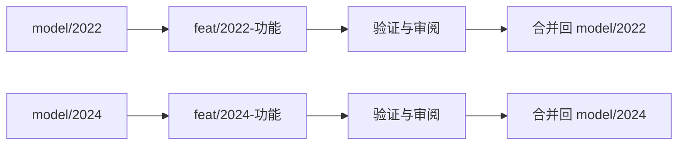

# 双年度主线开发流程

| 年份 | 功能起点 | 功能分支示例 | PR目标主线 | 代码目录 |
|---|---|---|---|---|
| 2022 | model/2022 | feat/2022-natural-drydown | model/2022 | models/2022 |
| 2024 | model/2024 | feat/2024-calendar | model/2024 | models/2024 |

2022和2024分别维护稳定代码、参数、功能合并及发布记录。main维护年度入口、归档说明和2026-10-26固定参考快照。

## 完成一个功能

1. 确定功能年份，读取本分支BRANCH_POLICY.json，更新对应年度主线。
2. 从该年度主线建立feat/年份-功能分支；问题修复使用fix/年份-问题，维护整理使用chore/年份-事项。
3. 完成代码修改及相应验证，在功能分支内更新该年度CHANGELOG，记录功能、参数变化、输入口径、运行ID和验证结果。
4. 创建PR，目标为表中同年份的model分支。PR正文说明功能行为、验证证据及结果变化，完成审阅。
5. 使用merge commit合并到对应年度主线，保留功能提交和汇合节点。合并后回读主线、代码和版本记录。

共用算法需要应用到两年时，为每条年度主线分别适配、验证和提交独立PR，保留各自配置及结果来源。模型代码和功能的集成目标由年份确定；main的PR用于导航和仓库级说明。

## 运行与版本

进入对应年度分支的models/年份目录，再按该目录README运行。SOURCE_MANIFEST路径相对于该年份目录。原始观测和大型栅格由数据项目提供，运行、缓存和检查材料保存在项目.codex-work。

模型规则和参数变化应检查对应年份的水量、浓度与系统出口负荷，保存输入、配置、代码哈希和运行ID。仅涉及文档和分支规则的调整，核对文件哈希、目标分支和文档链接。计算复现与独立观测评价分别报告。

年度分支的代码历史持续保留。main快照与旧仓库归档提供历史追溯入口，具体文件状态以对应提交和模型来源清单为准。
