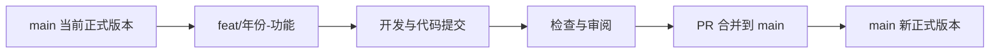

# 功能分支开发与主线合并

## 分支职责

| 分支 | 职责 |
|---|---|
| main | 已完成验证的正式代码，包含models/2022和models/2024 |
| feat/年份-功能 | 一个具体功能的开发、试算和修订，例如feat/2022-natural-drydown |
| fix/年份-问题 | 一个明确问题的修复，例如fix/2024-calendar |
| model/2022、model/2024 | 对应年份的开发与集成记录；本次两个年度模型包经各自PR合入main |
| archive/legacy-20261026 | 原仓库固定历史快照 |

功能分支名称中的年份对应要修改的模型目录。跨年份共用功能可以使用feat/shared-功能。继续使用年度分支开发时，先同步main，再开展改动；普通功能优先从最新main单独开分支。

## 一个功能的完整流程

1. 明确功能的目标、对应年份和验收结果，从最新main创建功能分支。
2. 在功能分支中修改对应模型目录。按完整的小步骤提交，每次写清改变的行为和原因。
3. 运行与改动相关的检查。模型规则或参数变化要核对水量、浓度、系统出口负荷及对应情景；保留输入、代码、配置哈希与运行批次。仅修改文档或目录时，检查链接、路径及入口即可。在功能分支内同步更新对应年份CHANGELOG，记录功能、运行ID与验证结论；仓库级变动同时更新根CHANGELOG，随本次功能提交。
4. 创建目标为main的PR，说明完成的功能、验证证据、参数/结果变化和需要的数据条件。审阅并处理实质问题。
5. 通过检查后，以merge方法合并PR。合并提交保留两个父节点，Git图可显示功能从主线分出、开发后再汇入主线。
6. 合并后回读main的合并提交、代码与版本记录，核对交付结果。分支与运行记录按用户的保留要求管理。

合并统一选择Create a merge commit（API的merge方法）。这会保留分支提交和独立的合并节点，便于查看每个功能加入主线的时间与内容。

## 提交与PR备注

提交标题直接描述完成的功能，例如“2022：增加自然晒田情景”。PR正文至少说明：

- 功能解决的问题及最终行为。
- 对应年份、配置，以及算法或参数的实际变化。
- 执行的检查、运行ID和结果对照。
- 输入数据及适用条件发生的变化。

原始研究批次日期与Git登记日期分别记录。历史摘要按其实际保存字段说明，代码与参数以来源清单和可执行配置为准。模型复现检查与独立观测评价分别报告。

## 目录和数据

正式模型代码按models/年份组织。各目录内部的运行说明和来源路径以该目录为根。运行数据由数据项目提供，本地工作材料、缓存、日志和临时检查保存在项目.codex-work；发布内容保留正式源码、配置、必要阈值和使用说明。

原项目的.codex及用户配置保持原有设置。旧仓库归档和历史提交继续用于追溯。任何合并均保留既有提交历史，并遵守仓库保护规则。
